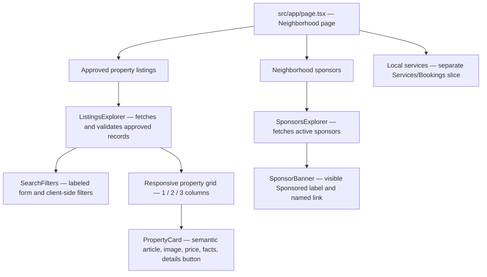

# Neighborhood Listing Platform

Connecting local residents, businesses, and essential services in one community hub.

## Deployment

- **Branch preview:** [https://neighborhood-listing-platform-git-exam-services-3868b7-dev-a365.vercel.app](https://neighborhood-listing-platform-git-exam-services-3868b7-dev-a365.vercel.app) (`exam/services-booking-eval`; Vercel account access required).
- This preview currently renders the page, but its property, service, and sponsor APIs need hosted Supabase environment variables before dynamic listing data will load. It is not the production deployment.

## Tech Stack
- **Framework:** Next.js (App Router)
- **Language:** TypeScript
- **Styling:** Tailwind CSS

## Lab 2 component hierarchy

The property and sponsor examples are synthetic local development records. The API only returns approved property listings and active sponsors.

## Lab 2 data and accessibility

- [`src/types/index.ts`](src/types/index.ts) exports `Property` and `Sponsor` from the runtime-validated Zod contracts so compile-time types stay aligned.
- Property image art is a local illustration with descriptive alternative text, not a photograph of a real listing.
- Search controls have explicit labels, filter error/status messages, and visible keyboard focus.
- [`docs/lab-2-evidence.md`](docs/lab-2-evidence.md) tracks required AI feedback, manual keyboard walkthrough, and Lighthouse evidence without fabricating results.
- [`docs/lab-2-ai-prompts.md`](docs/lab-2-ai-prompts.md) contains the prop-interface-only AI Studio prompt and review prompts.

## Project evidence

- [Stakeholder discovery package](docs/discovery-package.md): planning hypotheses, approval-gated research materials, candidate backlog, and planning handoff.
- Labs 3–5 implementation documentation: see `docs/adr/001-data-contract.md` and `docs/database-setup.md`.
